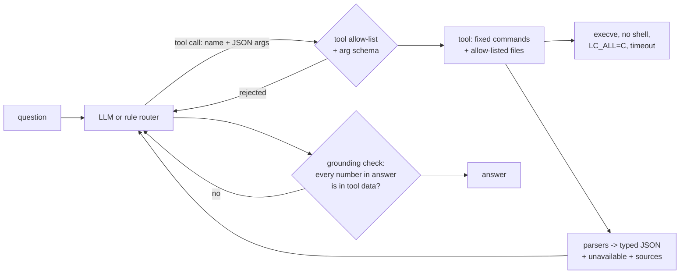

# hwqa: a hardware Q&A assistant for your Linux laptop

Ask about your machine in plain language. The assistant decides which facts it needs, reads them
through a fixed set of read-only tools, and answers only from what it read.

```
you> Can I add more RAM, and how much?
hwqa> You have 16 GB in 1 of 2 slots. The board supports up to 64 GB, so you can add a stick of up
      to 32 GB (for 48 GB total). Buy DDR4 SODIMM, 3200 MT/s or faster. (The maximum comes from the
      firmware; confirm it in the laptop's service manual.)
you> and what about the GPU?
hwqa> You have 1 GPU: Advanced Micro Devices, Inc. [AMD/ATI] Barcelo (driver amdgpu).
```

(Recorded ThinkPad E14 Gen 4, rule mode: `python -m hwqa --backend rules --sudo --fixtures fixtures/thinkpad-e14`.)

## Quick start

```bash
pip install -e .                 # only dependency: httpx
hwqa                             # chat; uses a local Ollama model if one is running, else rule mode
hwqa ask "Is my SSD NVMe?"
hwqa tools                       # what can be read on this machine, and what is missing
hwqa dump                        # every tool's structured output as JSON, no model involved
```

With a local model (recommended for natural answers; nothing leaves the laptop):

```bash
ollama pull qwen2.5:7b-instruct
hwqa --backend ollama -v         # -v shows which tools were called
```

Not on Linux? Replay a recorded machine: `hwqa --fixtures fixtures/legion-5` (also `thinkpad-e14`,
`minimal-vm`).

## Design



### Tool calling, not guessing

The model sees ten tools ([`hwqa/tools.py`](hwqa/tools.py)), each covering one area:
`get_system_info`, `get_cpu_info`, `get_memory_info`, `get_storage_info`, `get_disk_usage`,
`get_gpu_info`, `get_battery_info`, `get_network_adapters`, `get_temperatures`, `get_usb_devices`.

Tools are coarse on purpose. "Can I add RAM?" needs installed size, slots, empty slots, maximum
capacity, memory type and soldered memory; one `get_memory_info` call returns all of it, with the
upgrade arithmetic already done (`max_per_slot_gb`, `max_total_gb_keeping_current_modules`). Small
local models are much more reliable at picking one tool and reading a field than at chaining calls
and doing arithmetic.

Every tool returns the same shape:

```json
{
  "data": {"installed_gb": 16, "upgrade": {"used_slots": 1, "total_slots": 2, "max_supported_gb": 64, "max_per_slot_gb": 32}},
  "unavailable": [{"what": "...", "reason": "`dmidecode` needs root", "how_to_enable": "..."}],
  "sources": ["/proc/meminfo", "dmidecode -t 16 -t 17"]
}
```

`unavailable` is what makes "I don't know" possible: the model is told exactly what is missing,
why, and how the user can enable it.

### Safety: read-only and allow-listed, no arbitrary shell

Two layers ([`hwqa/system.py`](hwqa/system.py)):

1. **The model can only call tools.** Unknown tool names and unexpected arguments are rejected
   before anything runs, and the error is sent back to the model. The only free-text argument
   (`mountpoint` for `get_disk_usage`) is regex-checked and used only to filter results, never passed
   to a command.
2. **Tools can only run fixed commands.** `COMMANDS` maps an id to a binary plus a fixed argv
   (for example `dmidecode -t 16 -t 17`). Binaries are resolved only from `/usr/sbin`, `/usr/bin`,
   `/sbin`, `/bin` (a writable directory earlier in `$PATH` cannot plant a fake `lscpu`), run with
   `shell=False`, a clean environment (`LC_ALL=C` so output is parseable), stdin closed, a timeout,
   and an output cap. File reads are limited to an allow-list of `/proc`, `/sys` and `/etc/os-release`
   paths, with `..` rejected and symlink targets re-checked.

No model-provided string ever becomes part of an argv or a file path. Tests cover `rm -rf`,
`$(reboot)` and `; ...` injection attempts, `/etc/shadow` reads, and the PATH-hijack case.

### Permissions: what needs root

Only `dmidecode` (RAM slots, module sizes, maximum capacity) needs root here. Everything else comes
from unprivileged sources: `/proc/meminfo`, `/sys/class/dmi/id` (model, BIOS), `lscpu`, `lsblk`,
`lspci`, `/sys/class/power_supply`. Options, from what the code supports:

| Option | How | Trade-off |
|---|---|---|
| Run without root (default) | answers what it can and says which facts need root and how to enable them | nothing to install |
| Scoped sudo rule | install [`contrib/sudoers.d/hwqa`](contrib/sudoers.d/hwqa), run with `--sudo`; hwqa calls `sudo -n /usr/sbin/dmidecode -t 16 -t 17` | allows exactly one command with fixed arguments (not `-s system-serial-number`); `-n` means it never prompts or hangs |
| Run as root | `sudo hwqa` | works, but then the whole Python process and model client run as root; not recommended |

The assistant never asks for a password in the chat. A privileged helper daemon over a Unix socket
would be the next step for a desktop app; for a CLI, the sudoers rule gives the same least-privilege
property with far less code.

### Accuracy: no invented specs

- The system prompt forbids answering from general knowledge about laptop models and forbids doing
  arithmetic; derived numbers come from the tools.
- **Grounding check** ([`hwqa/grounding.py`](hwqa/grounding.py)): every number-with-a-unit in the
  answer (GB, GHz, %, °C, Wh, cores, slots...) must match a value in the tool results (allowing
  rounding, unit conversion from bytes or MHz, nothing else). If one does not, the model gets one retry
  with the bad figures named; if it still fails, the answer is shown with a note that the figure could
  not be verified. A model number like "5825U" is deliberately not allowed to vouch for "5.8 GHz".
- Missing data is explicit (`unavailable`), firmware-reported maximum RAM carries a caveat, and empty
  fields (`Unknown`, `Not Specified`, `To Be Filled By O.E.M.`) are normalised to null instead of being
  shown as values.

### Parsing and normalising

[`hwqa/parsers.py`](hwqa/parsers.py) turns each output into typed data: sizes in bytes, speeds in
MHz or MT/s, real booleans, nulls for placeholder strings. It handles real format differences:

- `lscpu -J` flat (util-linux 2.37) and nested `children` (2.38+), where cache keys change from
  `L2 cache` to `L2`.
- `lsblk -J` with real booleans and integers (newer) or `"0"`/`"1"` strings (older).
- `dmidecode` sizes in `GB` or `MB`, `No Module Installed`, soldered memory (`Row Of Chips`), and
  non-system memory arrays.
- Lenovo puts the marketing name in `product_version`, others in `product_name`.
- Disks are reported in decimal units (512 GB, as sold); RAM in GB as the OS reports it, with usable
  vs installed explained.

### Follow-ups

The conversation history (user turns, tool calls, tool results, answers) is sent to the model, so
"and what about the GPU?" or "which driver does it use?" resolves naturally. Tool results are cached
per session with a lifetime per tool (10 minutes for hardware that does not change, seconds for
battery, temperatures and disk usage). Old tool payloads are trimmed after six turns. In rule mode, a
question with no topic word reuses the previous topic.

### Portability

- At startup `capability_report` checks which binaries exist and whether root is available; the
  result goes into the system prompt and `hwqa tools`.
- Fallbacks: `/proc/cpuinfo` when `lscpu` is missing, `/sys/block` when `lsblk` is missing.
  Missing `pciutils`, `usbutils`, `dmidecode` or `nvidia-smi` become `unavailable` entries with the
  package to install.
- VMs and desktops (no battery, no thermal zones, no clock speed) are handled; see
  `fixtures/minimal-vm`.

### Privacy

- Default model is local (Ollama). Sending hardware data to a model that is not on `localhost`
  requires `--allow-remote`, and the banner says when data leaves the machine.
- Tools never read serial numbers, UUIDs, MAC or IP addresses, hostnames or usernames (paths like
  `/sys/class/net/*/address` and `product_serial` are denied), and a redaction pass scrubs anything
  that slips through.
- Rule mode needs no model at all.

## Backends

| `--backend` | What | Notes |
|---|---|---|
| `auto` (default) | Ollama if reachable with the model pulled, else rules | |
| `ollama` | native tool calling via `/api/chat` | default model `qwen2.5:7b-instruct`; `--model` to change |
| `openai` | any `/v1/chat/completions` server: llama.cpp, vLLM, LM Studio | remote URLs need `--allow-remote` |
| `rules` | keyword intent router + templated answers | deterministic; used by tests |

Small models sometimes print a tool call as JSON text instead of using `tool_calls`; the backend
accepts that form too, and it still goes through the same allow-list.

## Testing

```bash
pytest -q        # 45 tests on macOS; on Linux 5 more run against the real machine
```

- Recorded machines in [`fixtures/`](fixtures/): ThinkPad E14 Gen 4 (the brief's RAM example),
  Legion 5 (NVIDIA + AMD GPUs, full slots, HDD + NVMe, nested `lscpu`, older `lsblk`), and a minimal
  Debian VM (no `dmidecode`, `lspci`, `lsusb` or `lsblk`).
- The LLM loop is tested with scripted models (tool call -> answer, hallucination -> retry ->
  fixed, unfixable hallucination flagged, unknown-tool attempts, runaway tool calls capped) and the
  HTTP backends with mocked transports.
- [`tests/test_live_linux.py`](tests/test_live_linux.py) runs every tool against the real host. It is
  skipped on macOS, where this was written, so it has not been run yet.

## Limits (what is not done)

- I have not run it against a live Ollama model in this build; the model path is covered by scripted
  and mocked tests only. Answer quality with a real 3B-7B model still needs to be measured.
- The live Linux path (real `subprocess` calls on a Linux host) has not been run yet: development was on
  macOS, so parsing is verified against the recorded fixtures only. Run `pytest` on a Linux machine to
  exercise it.
- Rule mode answers fixed question types; anything outside them gets a help message.
- No GUI; CLI only, as the brief allows.

## Layout

```
hwqa/
  system.py      command + file allow-lists, safe runner, fixture replay
  parsers.py     raw output -> typed data
  tools.py       the ten tools, argument validation, redaction, capability report
  assistant.py   conversation loop, tool cache, grounding retry
  grounding.py   number-level answer verification
  backends.py    Ollama, OpenAI-compatible, rule-based
  cli.py         chat, ask, tools, dump
contrib/sudoers.d/hwqa   least-privilege rule for dmidecode
fixtures/                recorded machines
tests/                   45 tests (+5 live on Linux)
```
